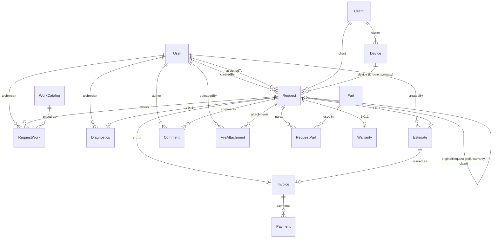

# ER-діаграма

## Легенда ключових зв'язків

- **Request** — центр моделі: клієнт + прилад + тип/статус/пріоритет + грошова
  ланцюжка (Diagnostics/Estimate/Invoice/Payment) + гарантія + комунікація.
- **Device → Request (1—N)** — історія сервісу конкретного приладу.
- **Request → Request (self)** — гарантійне звернення посилається на оригінальний ремонт.
- **WorkCatalog / Part → …Work/…Part (1—N)** — каталог + снапшот ціни в заявці
  (ціна фіксується на момент заявки, зміни прайсу не переписують історію).
- **Estimate → Invoice (1—0..1)** — рахунок видається лише з затвердженої оцінки.
- **Invoice → Payment (1—N)** — часткові оплати.
